# Loophole — Architecture Diagrams

Diagrams of the system as it is built today (Phases 1–2 done, Phase 3 in progress). Source of truth for the rules is `docs/ARCHITECTURE.md`; these pictures follow the code in `apps/` and `infra/`.

`architecture.excalidraw` has the system diagram (top) and the API low-level design (below it) as hand-drawn sketches. Open it at <https://excalidraw.com> or with the VS Code Excalidraw extension.

**High-level design (HLD)**

1. System and deployment
2. Backend modules and layers
3. Flow: submit an exercise
4. Flow: live duel
5. Data model

**Low-level design (LLD)**

6. Classes: learning path (lessons, submissions, XP, AI, certificates)
7. Classes: duels
8. Pure rule functions and who calls them
9. State: duel lifecycle (server)
10. State: duel room (client)
11. State: lesson unlocks and the streak rule
12. Frontend layers

`certificates` (diagrams 6 and 8) is uncommitted work in progress and is not in the HLD diagrams yet.

## 1. System and deployment

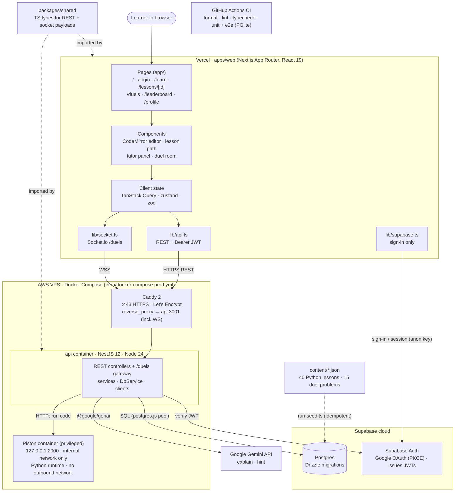

Why it looks like this:

- The browser only talks to Supabase Auth to sign in. Every other call goes through the API, so hidden tests, duel solutions and API keys stay on the server.
- Piston needs a privileged container, so it runs on the same VPS as the API. Only the internal Docker network can reach it.
- Matchmaking, duel timers and the Piston run queue live in memory, so v1 runs exactly one API instance.

## 2. Backend modules and layers

Controllers and the gateway only validate and delegate (ADR-015). Services hold the rules. Each outside system has exactly one client class.

```mermaid
flowchart TB
    subgraph global["Global request pipeline (app.module.ts)"]
        direction LR
        guard["JwtAuthGuard<br/>@Public() skips"] --> throttle["HttpThrottlerGuard<br/>120 req/min per user"] --> pipe["ValidationPipe<br/>class-validator DTOs"] --> filter["HttpExceptionFilter<br/>{ error: { code, message } }"]
    end

    subgraph ctl["Controllers / Gateway"]
        cMe["UsersController<br/>GET · PATCH /me"]
        cCourses["CoursesController<br/>GET /courses · /courses/:slug/path"]
        cLessons["LessonsController<br/>GET /lessons/:id"]
        cSub["SubmissionsController<br/>POST · GET /submissions"]
        cWeekly["LeaderboardController<br/>GET /leaderboard/weekly"]
        cRating["RatingsController<br/>GET /leaderboard/rating"]
        cAi["AiController<br/>POST /ai/explain · /ai/hint"]
        cHealth["HealthController<br/>GET /health"]
        gDuels["DuelsGateway (Socket.io /duels)<br/>queue:join · queue:leave<br/>duel:submit · duel:forfeit"]
    end

    subgraph svc["Services (business rules + Drizzle queries)"]
        sUsers["UsersService"]
        sLessons["LessonsService<br/>lesson states / unlocks"]
        sSub["SubmissionsService<br/>grading.ts · run-tests.ts"]
        sGam["GamificationService<br/>XP · streaks (IST days)"]
        sRat["RatingsService<br/>elo.ts"]
        sAi["AiService<br/>tutor guards · daily cap"]
        sDuels["DuelsService<br/>duel-rules.ts · timers"]
        sMatch["MatchmakingService<br/>in-memory queue"]
        sHealth["HealthService"]
    end

    subgraph infra["Shared infrastructure"]
        db["DbService<br/>one Drizzle instance"]
        piston["PistonClient<br/>serial run queue (ADR-018)"]
        gem["GeminiClient<br/>only importer of @google/genai"]
        sba["SupabaseAuthClient<br/>token checks"]
    end

    global --> ctl
    cMe --> sUsers
    cCourses --> sLessons
    cLessons --> sLessons
    cSub --> sSub
    cWeekly --> sGam
    cRating --> sRat
    cAi --> sAi
    cHealth --> sHealth
    gDuels --> sDuels

    sUsers --> sGam
    sUsers --> sRat
    sSub --> sLessons
    sSub --> sUsers
    sSub --> sGam
    sAi --> sLessons
    sAi --> sUsers
    sDuels --> sMatch
    sDuels --> sUsers
    sDuels --> sRat

    sSub --> piston
    sDuels --> piston
    sHealth --> piston
    sAi --> gem
    guard --> sba
    gDuels --> sba
    svc --> db
```

## 3. Flow: submit an exercise

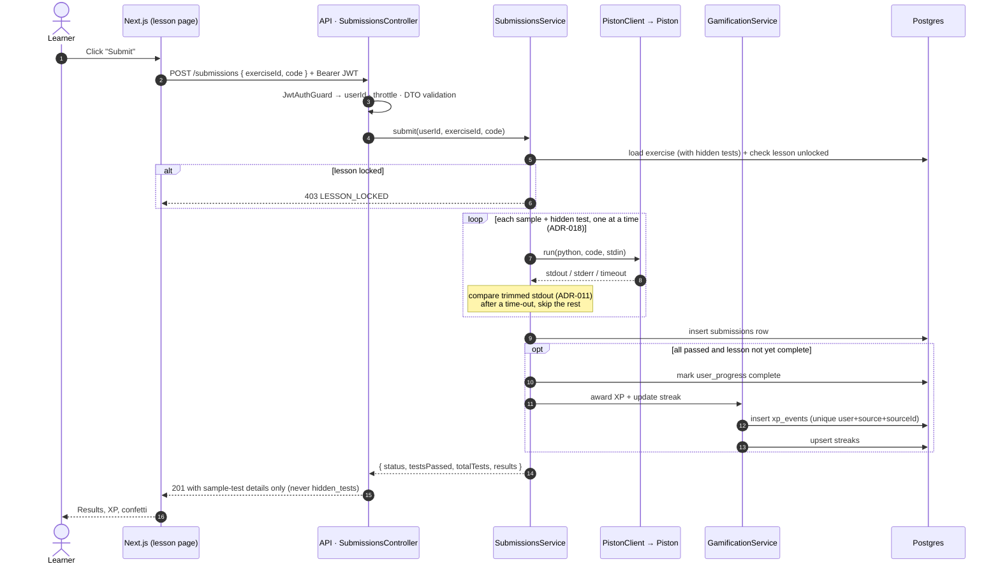

## 4. Flow: live duel

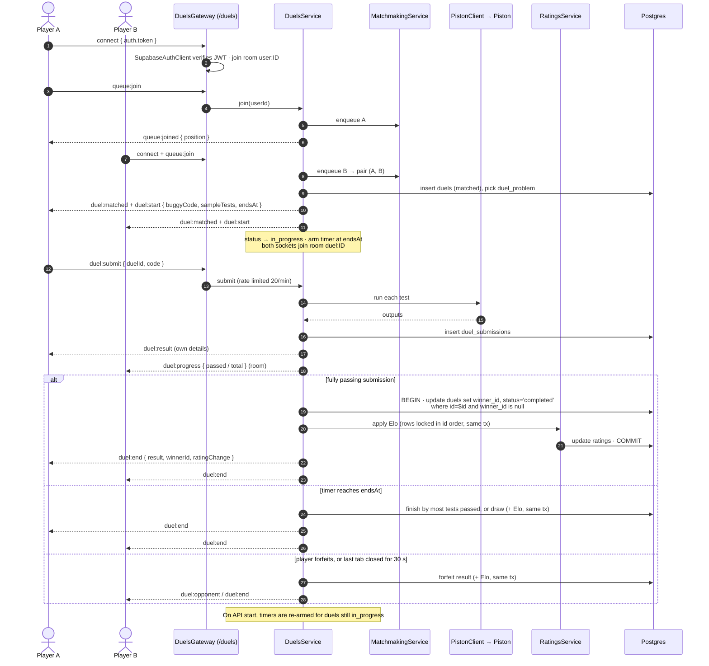

## 5. Data model

`auth.users` belongs to Supabase. Every user-owned table hangs off `profiles` with `on delete cascade`.

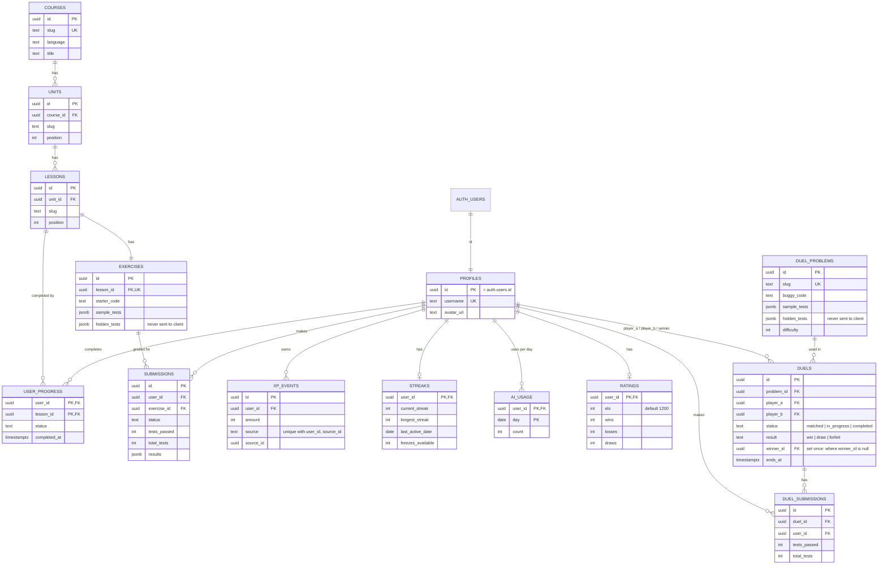

---

# Low-level design

The LLD follows the plain-NestJS rules in `docs/ARCHITECTURE.md` §2 (ADR-015):

- Controllers and the gateway are thin.
- Services own the rules and the Drizzle queries.
- The rules that are easy to get wrong live in pure functions with no I/O, so they can be unit-tested.
- Each outside system sits behind exactly one client class.
- Dependency injection is by class. There are no interfaces or tokens.

## 6. Classes: learning path

Every service also depends on `DbService`. Those arrows are left out to keep the picture readable.

```mermaid
classDiagram
    direction TB

    class CoursesController {
        <<controller>>
        +list() CourseSummary[]
        +path(user, slug) CoursePath
    }
    class LessonsController {
        <<controller>>
        +get(user, id) LessonDetail
    }
    class SubmissionsController {
        <<controller>>
        +create(user, dto) SubmissionResult
        +list(user, query) SubmissionSummary[]
    }
    class UsersController {
        <<controller>>
        +getMe(user) MeResponse
        +updateMe(user, dto) MeResponse
    }
    class LeaderboardController {
        <<controller>>
        +weekly(user, query) WeeklyLeaderboard
    }
    class AiController {
        <<controller>>
        +explain(user, dto) ExplainResponse
        +hint(user, dto) HintResponse
    }
    class CertificatesController {
        <<in progress>>
        +listMine(user) CertificateSummary[]
        +getPublic(slug) PublicCertificate
    }

    class LessonsService {
        <<service>>
        +listCourses() CourseSummary[]
        +getPath(userId, courseSlug) CoursePath
        +getLesson(userId, lessonId) LessonDetail
        +assertUnlocked(userId, lessonId, courseId) void
        -orderedLessons(courseId)
        -statesFor(userId, courseId)
    }
    class SubmissionsService {
        <<service>>
        +submit(user, dto) SubmissionResult
        +list(userId, exerciseId) SubmissionSummary[]
    }
    class GamificationService {
        <<service>>
        +awardLesson(userId, lessonId) xpAwarded
        +stats(userId) xpAndStreak
        +weekly(userId, limit) WeeklyLeaderboard
        -streakState(userId)
    }
    class CertificatesService {
        <<in progress>>
        +issueIfComplete(userId, lessonId) slugOrNull
        +listMine(userId) CertificateSummary[]
        +getPublic(slug) PublicCertificate
    }
    class UsersService {
        <<service>>
        +getMe(user) MeResponse
        +ensureProfile(user) void
        +updateMe(user, dto) MeResponse
        -getOrCreate(user) Profile
        -toMe(profile) MeResponse
    }
    class RatingsService {
        <<service>>
        +elosOf(userIds) Map
    }
    class AiService {
        <<service>>
        -dailyLimit number
        +explain(user, submissionId) ExplainResponse
        +hint(user, dto) HintResponse
        -withDailyCap(userId, fn)
    }

    class PistonClient {
        <<client>>
        -queue Promise
        +isUp() boolean
        +run(language, code, stdin) RunResult
        -execute(language, code, stdin) RunResult
    }
    class GeminiClient {
        <<client>>
        -ai GoogleGenAI
        -model string
        +explainError(input) explanationAndLine
        +giveHint(input) hint
        -generate(kind, prompt)
    }
    class DbService {
        <<infrastructure>>
        +drizzle Db
        +onModuleDestroy() void
    }
    class RunResult {
        <<type>>
        +stdout string
        +stderr string
        +exitCode number
        +timedOut boolean
    }

    CoursesController --> LessonsService
    LessonsController --> LessonsService
    SubmissionsController --> SubmissionsService
    UsersController --> UsersService
    LeaderboardController --> GamificationService
    AiController --> AiService
    CertificatesController --> CertificatesService

    SubmissionsService --> LessonsService : assertUnlocked
    SubmissionsService --> UsersService : ensureProfile
    SubmissionsService --> GamificationService : awardLesson
    SubmissionsService --> CertificatesService : issueIfComplete
    SubmissionsService --> PistonClient : run via runTests
    AiService --> LessonsService : assertUnlocked
    AiService --> UsersService : ensureProfile
    AiService --> GeminiClient : explainError, giveHint
    UsersService --> GamificationService : stats
    UsersService --> RatingsService : elosOf
    PistonClient ..> RunResult
    GamificationService ..> DbService : every service uses DbService
```

## 7. Classes: duels

Socket events reach `DuelsGateway`, and it hands each one to `DuelsService`. `DuelsService` owns all live duel state: timers, absent-player timers and the per-user rate limit. It pushes events back through the Socket.io namespace it receives in `attach(io)`.

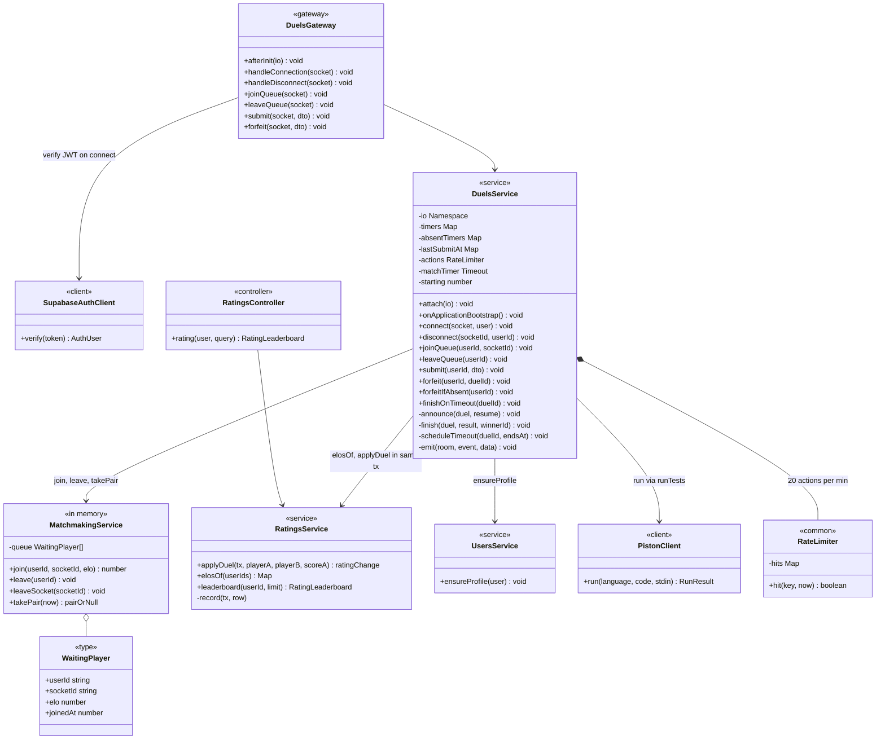

Notes on `DuelsService` state:

- `timers`: one per running duel (duelId to timeout). Its size is the active-duel count, capped at 20.
- `absentTimers`: one per player whose last tab closed (userId to timeout). It fires the 30 s forfeit.
- `lastSubmitAt`: enforces one `duel:submit` every 3 s per player.
- `onApplicationBootstrap()`: re-arms timers for duels still `in_progress`.

## 8. Pure rule functions and who calls them

These files do no I/O. They hold the logic AGENTS.md rule 6 says to test: grading, streaks, Elo and the duel winner. Each has a spec in `__tests__/`.

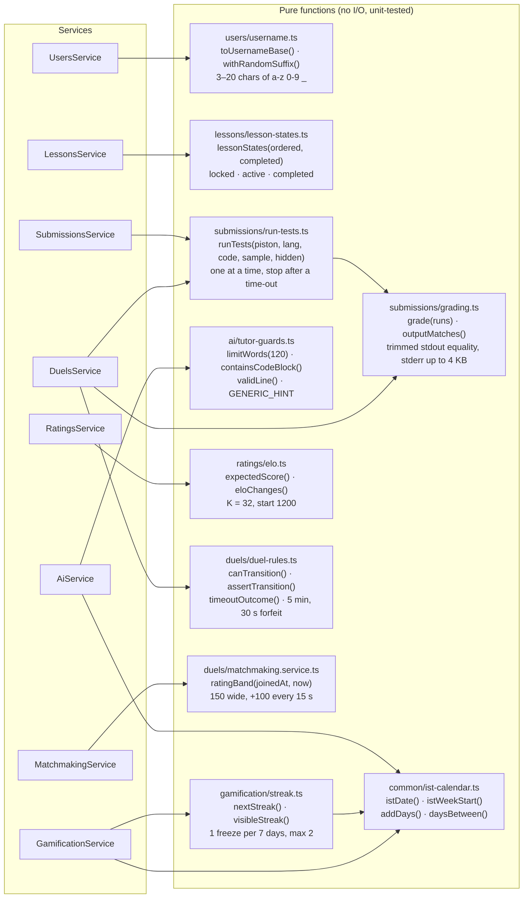

## 9. State: duel lifecycle (server)

`duel-rules.ts` allows only these steps. `assertTransition` throws `409 ILLEGAL_TRANSITION` on any other step. `waiting` exists only in memory (the matchmaking queue). The other states are `duels.status` in Postgres.

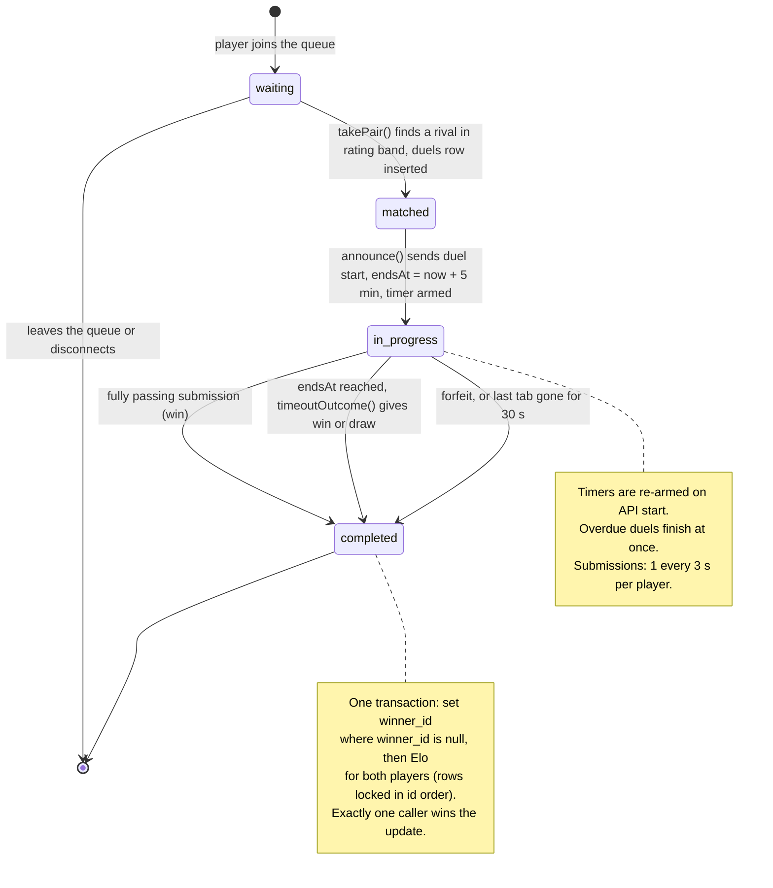

## 10. State: duel room (client)

The `/duels` page keeps the duel in a `useReducer` (`apps/web/lib/use-duel-socket.ts`). Server events drive every transition. The client never decides the result.

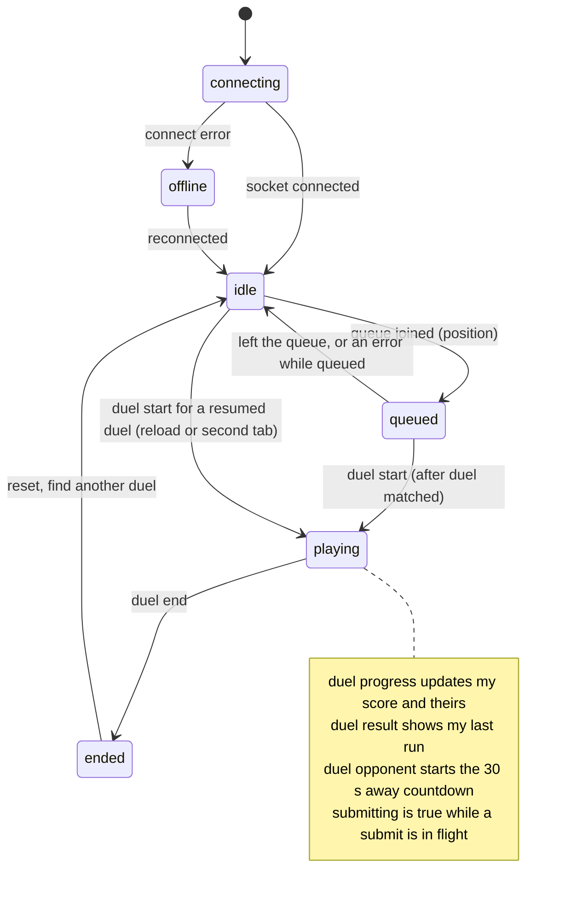

## 11. State: lesson unlocks and the streak rule

`lessonStates()` walks the course in path order. Completed lessons stay open, the first unfinished lesson is active, and every lesson after it is locked. `LessonsService.assertUnlocked` applies it to submissions and AI hints too, so a locked lesson is blocked on the server, not just hidden in the UI.

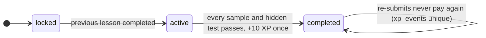

`nextStreak(prev, today)` runs when a lesson is completed for the first time. Days are IST calendar days.

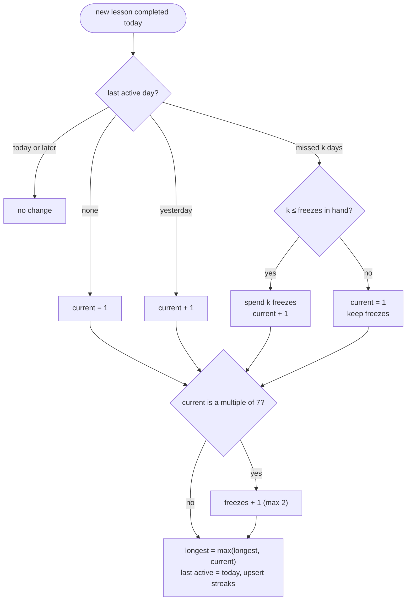

## 12. Frontend layers

Pages never call `fetch` or Socket.io directly. Data goes through TanStack Query hooks, then `apiFetch`. The duel room goes through `useDuelSocket`, then `connectDuels()`. Both attach the Supabase access token, and both are typed with `@loophole/shared`.

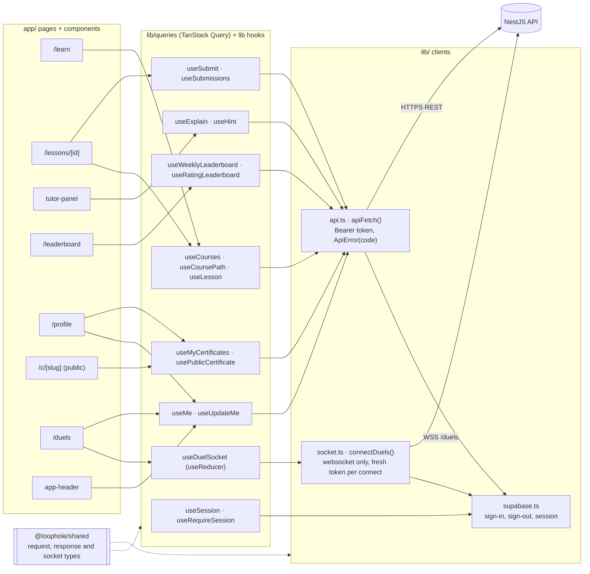
