# Loophole — Architecture Diagrams

Diagrams of the system as it is built today: Phases 1 and 2 done, Phase 3 features through ADR-053. The rules live in `docs/ARCHITECTURE.md`; these pictures follow the code in `apps/` and `infra/`. Everything is black on white.

**Pictures (hand-drawn style)**

- [`system-design.svg`](system-design.svg): the whole system on one page.
- [`api-lld.svg`](api-lld.svg): every API controller, service and rule file.
- [`architecture.excalidraw`](architecture.excalidraw): the source of both. Open it at <https://excalidraw.com> or with the VS Code Excalidraw extension to edit, then export each half as SVG.

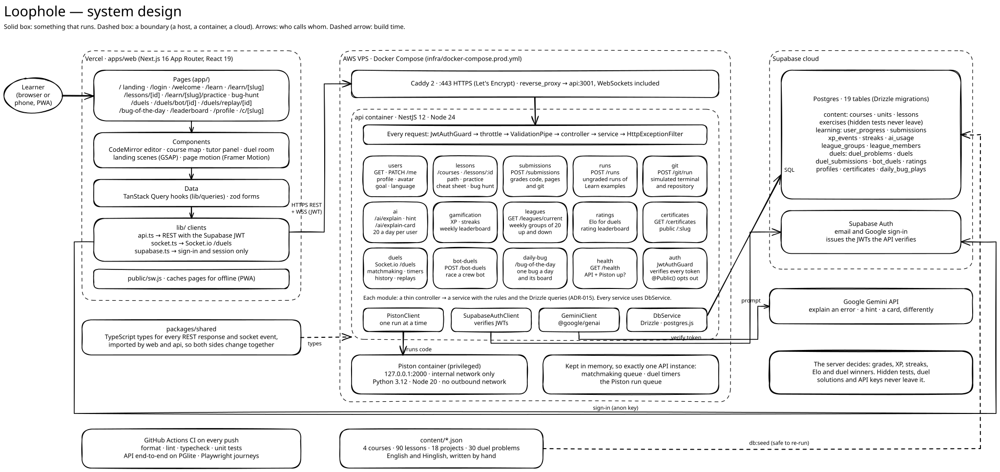

**High-level design (HLD)**

1. System and deployment
2. Backend modules and layers
3. Flow: submit an exercise
4. Flow: live duel
5. Flow: practice duel against a bot
6. Data model

**Low-level design (LLD)**

7. Classes: learning (lessons, submissions, runs, git, AI, XP, leagues, certificates, Bug of the day)
8. Classes: duels (live, history, bots)
9. Pure rule functions and who calls them
10. State: duel lifecycle (server)
11. State: duel room (client)
12. State: lesson unlocks
13. Flow: the streak rule
14. Frontend layers

## 1. System and deployment

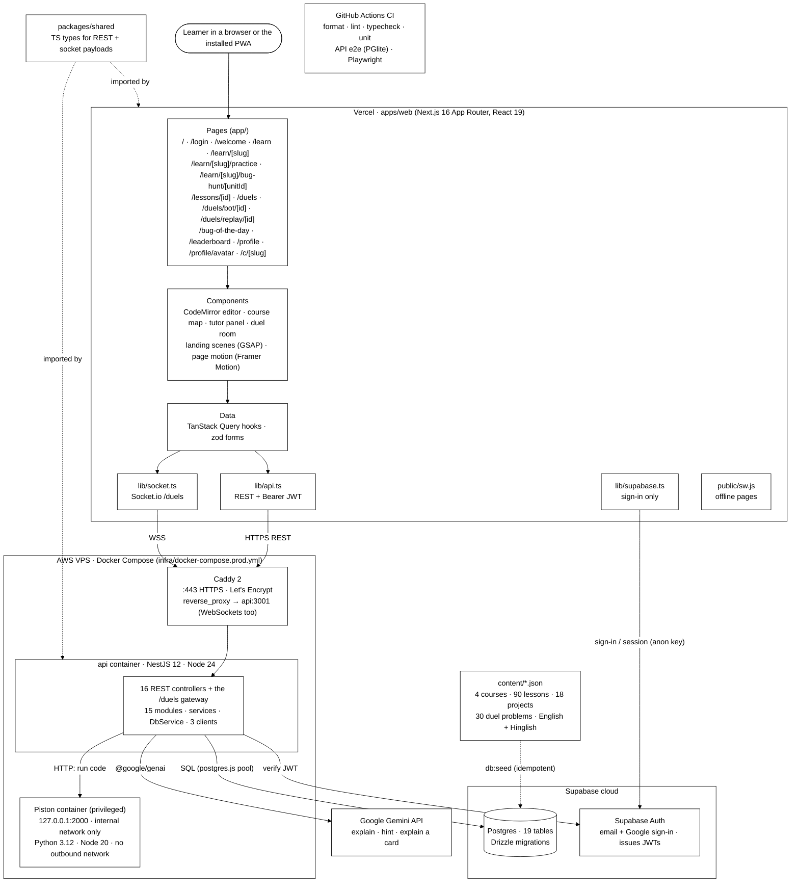

Why it looks like this:

- The browser only talks to Supabase Auth to sign in. Every other call goes through the API, so hidden tests, duel solutions and API keys stay on the server.
- Piston needs a privileged container, so it runs on the same VPS as the API. Only the internal Docker network can reach it.
- Matchmaking, duel timers and the Piston run queue live in memory, so v1 runs exactly one API instance.
- HTML & CSS exercises are never run: the API parses and checks them (ADR-024). Git exercises run in a simulated terminal in the API (ADR-026). Only Python and JavaScript go to Piston.

## 2. Backend modules and layers

Controllers and the gateway only validate and delegate (ADR-015). Services hold the rules. Each outside system has exactly one client class.

```mermaid
%%{init: {"theme": "base", "themeVariables": {"background": "#ffffff", "primaryColor": "#ffffff", "primaryTextColor": "#000000", "primaryBorderColor": "#000000", "secondaryColor": "#ffffff", "tertiaryColor": "#ffffff", "lineColor": "#000000", "textColor": "#000000", "mainBkg": "#ffffff", "nodeBorder": "#000000", "clusterBkg": "#ffffff", "clusterBorder": "#000000", "edgeLabelBackground": "#ffffff", "titleColor": "#000000"}}}%%
flowchart TB
    subgraph global["Global request pipeline (app.module.ts)"]
        direction LR
        guard["JwtAuthGuard<br/>@Public() skips"] --> throttle["HttpThrottlerGuard<br/>120 req/min per user"] --> pipe["ValidationPipe<br/>class-validator DTOs"] --> filter["HttpExceptionFilter<br/>{ error: { code, message } }"]
    end

    subgraph ctl["Controllers / Gateway"]
        cMe["UsersController<br/>GET · PATCH /me · GET /me/activity"]
        cCourses["CoursesController<br/>/courses · /:slug/path · /:slug/practice<br/>/:slug/units/:id/cheatsheet · /bug-hunt"]
        cLessons["LessonsController<br/>GET /lessons/:id"]
        cSub["SubmissionsController<br/>POST · GET /submissions"]
        cRuns["RunsController<br/>POST /runs"]
        cGit["GitController<br/>POST /git/run"]
        cAi["AiController<br/>/ai/explain · /ai/hint · /ai/explain-card"]
        cWeekly["LeaderboardController<br/>GET /leaderboard/weekly"]
        cLeague["LeaguesController<br/>GET /leagues/current"]
        cRating["RatingsController<br/>GET /leaderboard/rating"]
        cCert["CertificatesController<br/>GET /certificates · /:slug (public)"]
        cDaily["DailyBugController<br/>/bug-of-the-day · /board · /submissions"]
        cHist["DuelsController<br/>/duels/history · /duels/:id/replay"]
        cBots["BotDuelsController<br/>/bot-duels · /:id · /submissions · /forfeit"]
        cHealth["HealthController<br/>GET /health (public)"]
        gDuels["DuelsGateway (Socket.io /duels)<br/>queue:join · queue:leave<br/>duel:submit · duel:forfeit"]
    end

    subgraph svc["Services (business rules + Drizzle queries)"]
        sUsers["UsersService"]
        sLessons["LessonsService<br/>unlocks · Hinglish"]
        sSub["SubmissionsService<br/>code · pages · git"]
        sRuns["RunsService"]
        sGit["GitService"]
        sAi["AiService<br/>daily cap"]
        sGam["GamificationService<br/>XP · streaks"]
        sLeague["LeaguesService"]
        sRat["RatingsService<br/>Elo"]
        sCert["CertificatesService"]
        sDaily["DailyBugService"]
        sHist["DuelHistoryService"]
        sBots["BotDuelsService"]
        sDuels["DuelsService<br/>timers"]
        sMatch["MatchmakingService<br/>in-memory queue"]
        sHealth["HealthService"]
    end

    subgraph infra["Shared infrastructure"]
        db["DbService<br/>one Drizzle instance"]
        piston["PistonClient<br/>serial run queue (ADR-018)"]
        gem["GeminiClient<br/>only importer of @google/genai"]
        sba["SupabaseAuthClient<br/>token checks"]
    end

    global --> ctl
    cMe --> sUsers
    cCourses --> sLessons
    cLessons --> sLessons
    cSub --> sSub
    cRuns --> sRuns
    cGit --> sGit
    cAi --> sAi
    cWeekly --> sGam
    cLeague --> sLeague
    cRating --> sRat
    cCert --> sCert
    cDaily --> sDaily
    cHist --> sHist
    cBots --> sBots
    cHealth --> sHealth
    gDuels --> sDuels

    sUsers --> sGam
    sUsers --> sRat
    sSub --> sLessons
    sSub --> sUsers
    sSub --> sGam
    sSub --> sCert
    sRuns --> sLessons
    sGit --> sLessons
    sAi --> sLessons
    sAi --> sUsers
    sGam --> sLeague
    sDaily --> sUsers
    sDaily --> sGam
    sBots --> sUsers
    sDuels --> sMatch
    sDuels --> sUsers
    sDuels --> sRat

    sSub --> piston
    sRuns --> piston
    sDaily --> piston
    sBots --> piston
    sDuels --> piston
    sHealth --> piston
    sAi --> gem
    guard --> sba
    gDuels --> sba
    svc --> db
```

## 3. Flow: submit an exercise

`exerciseKind(language)` picks the grader: Python and JavaScript run in Piston, HTML & CSS pages are parsed and checked, Git commands run in a simulated repository.

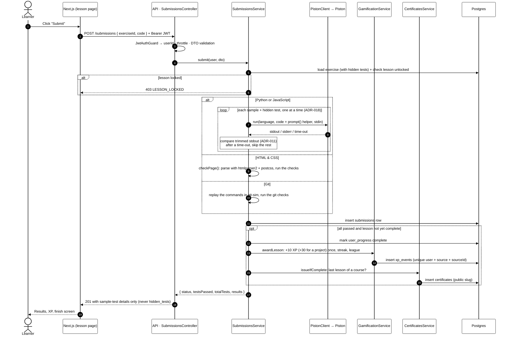

## 4. Flow: live duel

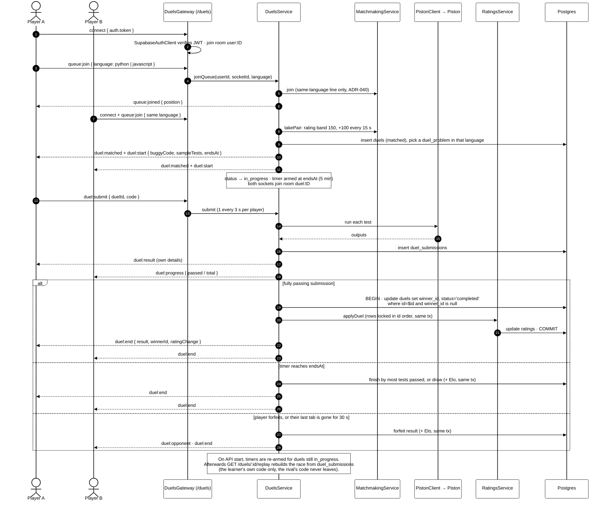

## 5. Flow: practice duel against a bot

No socket and no second player (ADR-039): the bot's whole race is decided when the duel starts, and every read checks the clock against it.

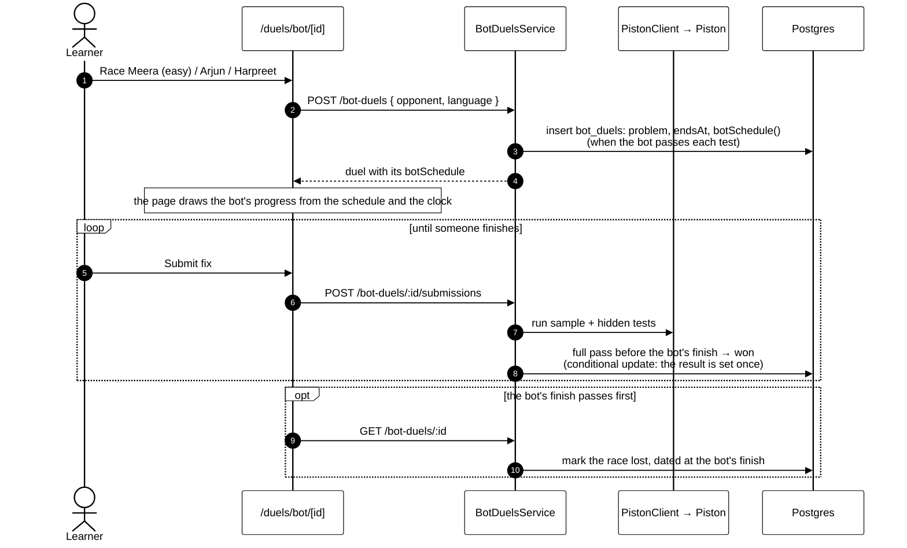

## 6. Data model

`auth.users` belongs to Supabase. Every user-owned table hangs off `profiles` with `on delete cascade`.

```mermaid
%%{init: {"theme": "base", "themeVariables": {"background": "#ffffff", "primaryColor": "#ffffff", "primaryTextColor": "#000000", "primaryBorderColor": "#000000", "lineColor": "#000000", "textColor": "#000000", "mainBkg": "#ffffff", "nodeBorder": "#000000", "attributeBackgroundColorOdd": "#ffffff", "attributeBackgroundColorEven": "#ffffff"}}}%%
erDiagram
    AUTH_USERS ||--|| PROFILES : "id"
    COURSES ||--o{ UNITS : has
    UNITS ||--o{ LESSONS : has
    LESSONS ||--|| EXERCISES : has
    PROFILES ||--o{ USER_PROGRESS : completes
    LESSONS ||--o{ USER_PROGRESS : "completed by"
    PROFILES ||--o{ SUBMISSIONS : makes
    EXERCISES ||--o{ SUBMISSIONS : "graded for"
    PROFILES ||--o{ XP_EVENTS : earns
    PROFILES ||--o| STREAKS : has
    PROFILES ||--o{ AI_USAGE : "uses per day"
    PROFILES ||--o| RATINGS : has
    PROFILES ||--o{ CERTIFICATES : earns
    COURSES ||--o{ CERTIFICATES : "certifies"
    LEAGUE_GROUPS ||--o{ LEAGUE_MEMBERS : has
    PROFILES ||--o{ LEAGUE_MEMBERS : "one per week"
    DUEL_PROBLEMS ||--o{ DUELS : "used in"
    PROFILES ||--o{ DUELS : "player_a / player_b / winner"
    DUELS ||--o{ DUEL_SUBMISSIONS : has
    PROFILES ||--o{ DUEL_SUBMISSIONS : makes
    DUEL_PROBLEMS ||--o{ BOT_DUELS : "used in"
    PROFILES ||--o{ BOT_DUELS : races
    DUEL_PROBLEMS ||--o{ DAILY_BUG_PLAYS : "bug of the day"
    PROFILES ||--o{ DAILY_BUG_PLAYS : "one per day"

    PROFILES {
        uuid id PK "= auth.users.id"
        text username UK
        text avatar "avatar maker code (ADR-046)"
        smallint daily_goal "XP a day"
        text lesson_language "en | hinglish"
    }
    COURSES {
        uuid id PK
        text slug UK
        text language "python | javascript | html | git"
        text title
        text description
    }
    UNITS {
        uuid id PK
        uuid course_id FK
        text slug
        text title
        int position
    }
    LESSONS {
        uuid id PK
        uuid unit_id FK
        text slug
        text title
        int position
        jsonb learn "cards, quick check, bug cards; + Hinglish"
        boolean is_project
    }
    EXERCISES {
        uuid id PK
        uuid lesson_id FK, UK
        text prompt
        text prompt_hi
        text starter_code
        jsonb sample_tests
        jsonb hidden_tests "never sent to client"
        jsonb checks "HTML & CSS rules"
        jsonb git_scenario "Git exercises"
    }
    USER_PROGRESS {
        uuid user_id PK, FK
        uuid lesson_id PK, FK
        text status
        timestamptz completed_at
    }
    SUBMISSIONS {
        uuid id PK
        uuid user_id FK
        uuid exercise_id FK
        text code
        text status
        int tests_passed
        int total_tests
        jsonb results
    }
    XP_EVENTS {
        uuid id PK
        uuid user_id FK
        int amount
        text source "unique with user_id, source_id"
        uuid source_id
    }
    STREAKS {
        uuid user_id PK, FK
        int current_streak
        int longest_streak
        date last_active_date
        int freezes_available
    }
    AI_USAGE {
        uuid user_id PK, FK
        date day PK
        int count "max 20"
    }
    RATINGS {
        uuid user_id PK, FK
        int elo "default 1200"
        int wins
        int losses
        int draws
    }
    CERTIFICATES {
        uuid id PK
        uuid user_id FK
        uuid course_id FK
        text public_slug UK
        timestamptz issued_at
    }
    LEAGUE_GROUPS {
        uuid id PK
        date week_start
        smallint tier "Bronze to Diamond"
    }
    LEAGUE_MEMBERS {
        date week_start PK
        uuid user_id PK, FK
        uuid group_id FK
    }
    DUEL_PROBLEMS {
        uuid id PK
        text slug UK
        text language
        text title
        text buggy_code
        jsonb sample_tests
        jsonb hidden_tests "never sent to client"
        int difficulty
    }
    DUELS {
        uuid id PK
        uuid problem_id FK
        uuid player_a FK
        uuid player_b FK
        text status "matched | in_progress | completed"
        text result "win | draw | forfeit"
        uuid winner_id FK "set once: where winner_id is null"
        timestamptz ends_at
    }
    DUEL_SUBMISSIONS {
        uuid id PK
        uuid duel_id FK
        uuid user_id FK
        text code
        int tests_passed
        int total_tests
    }
    BOT_DUELS {
        uuid id PK
        uuid user_id FK
        uuid problem_id FK
        text opponent "meera | arjun | harpreet"
        jsonb bot_schedule
        text result "set once"
        timestamptz ends_at
    }
    DAILY_BUG_PLAYS {
        uuid id PK
        uuid user_id FK
        date day "IST"
        uuid problem_id FK
        timestamptz opened_at
        timestamptz solved_at
        int attempts
    }
```

---

# Low-level design

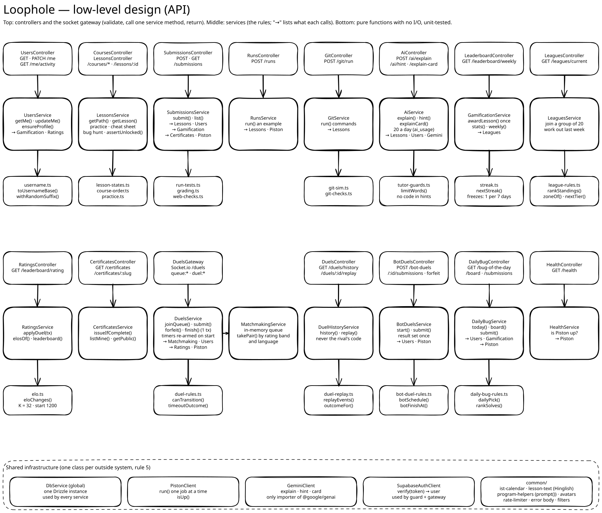

The LLD follows the plain-NestJS rules in `docs/ARCHITECTURE.md` §2 (ADR-015):

- Controllers and the gateway are thin.
- Services own the rules and the Drizzle queries.
- The rules that are easy to get wrong live in pure functions with no I/O, so they can be unit-tested.
- Each outside system sits behind exactly one client class.
- Dependency injection is by class. There are no interfaces or tokens.

## 7. Classes: learning

Every service also depends on `DbService`. Those arrows are left out to keep the picture readable.

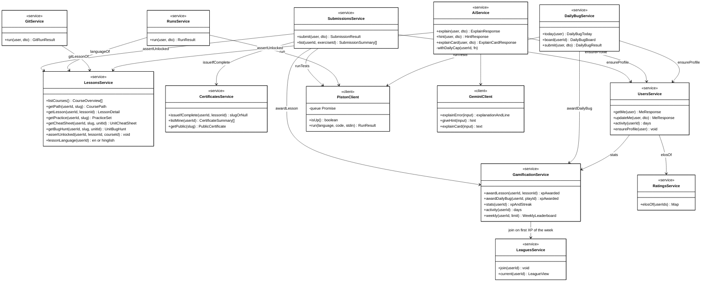

## 8. Classes: duels

Socket events reach `DuelsGateway`, and it hands each one to `DuelsService`. `DuelsService` owns all live duel state: timers, absent-player timers and the per-user rate limit. Replays and bot duels are plain HTTP.

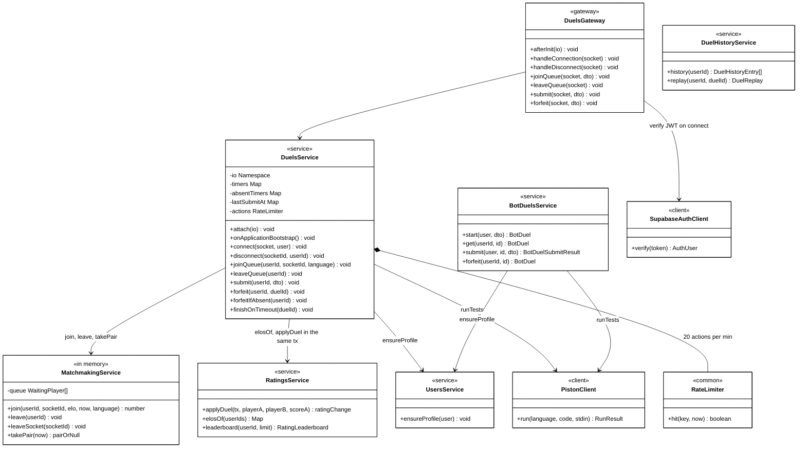

Notes on `DuelsService` state:

- `timers`: one per running duel (duelId to timeout). Its size is the active-duel count, capped at 20.
- `absentTimers`: one per player whose last tab closed (userId to timeout). It fires the 30 s forfeit.
- `lastSubmitAt`: enforces one `duel:submit` every 3 s per player.
- `onApplicationBootstrap()`: re-arms timers for duels still `in_progress`.

## 9. Pure rule functions and who calls them

These files do no I/O. They hold the logic AGENTS.md rule 6 says to test: grading, streaks, Elo and the duel winner, and the newer rules for leagues, bots, Bug of the day and Git. Each has a spec in `__tests__/`.

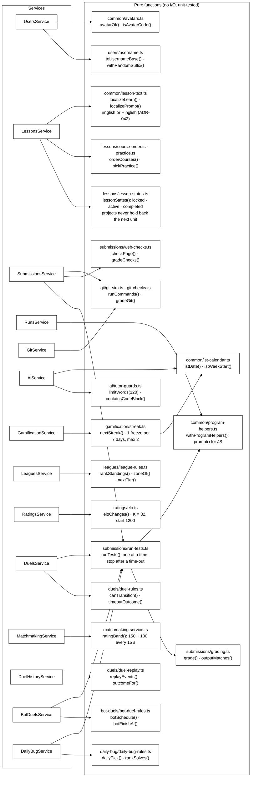

## 10. State: duel lifecycle (server)

`duel-rules.ts` allows only these steps. `assertTransition` throws `409 ILLEGAL_TRANSITION` on any other step. `waiting` exists only in memory (the matchmaking queue). The other states are `duels.status` in Postgres.

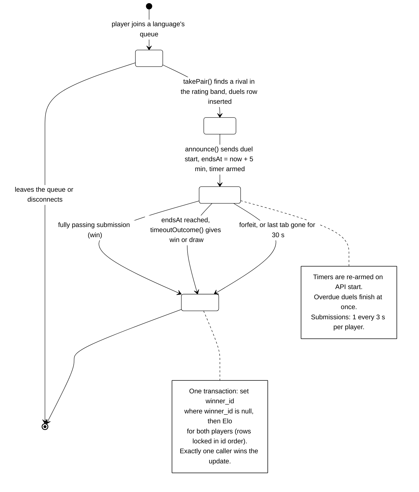

## 11. State: duel room (client)

The `/duels` page keeps the duel in a `useReducer` (`apps/web/lib/use-duel-socket.ts`). Server events drive every transition. The client never decides the result.

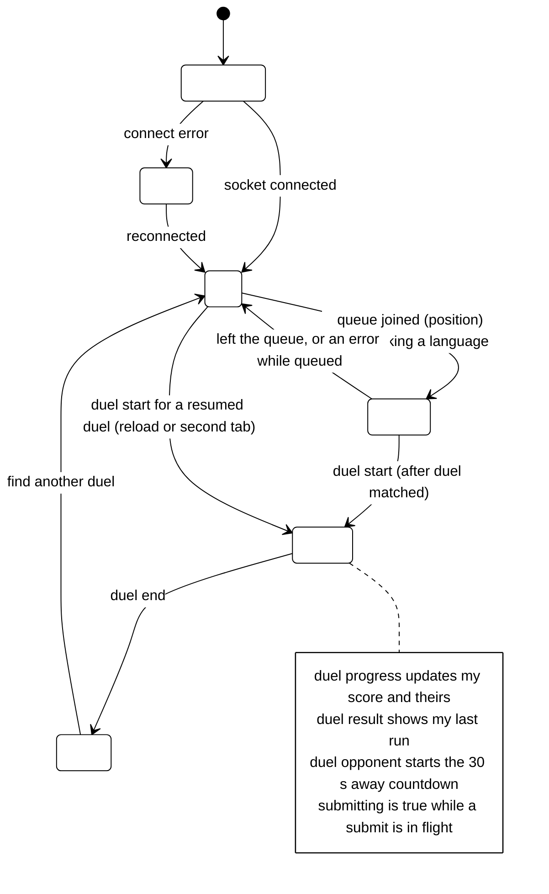

## 12. State: lesson unlocks

`lessonStates()` walks the course in path order. Completed lessons stay open, the first unfinished lesson is active, and every lesson after it is locked. A unit's project opens when the lesson before it is done but never holds back the next unit (ADR-043). `LessonsService.assertUnlocked` applies the same rule to submissions and AI calls, so a locked lesson is blocked on the server, not just hidden in the UI.

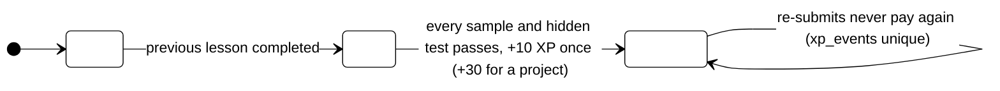

## 13. Flow: the streak rule

`nextStreak(prev, today)` runs when a lesson is completed for the first time. Days are IST calendar days.

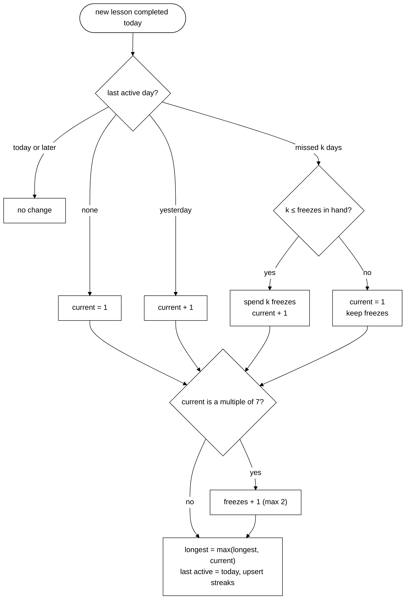

## 14. Frontend layers

Pages never call `fetch` or Socket.io directly. Data goes through TanStack Query hooks, then `apiFetch`. The duel room goes through `useDuelSocket`, then `connectDuels()`. Both attach the Supabase access token, and both are typed with `@loophole/shared`.

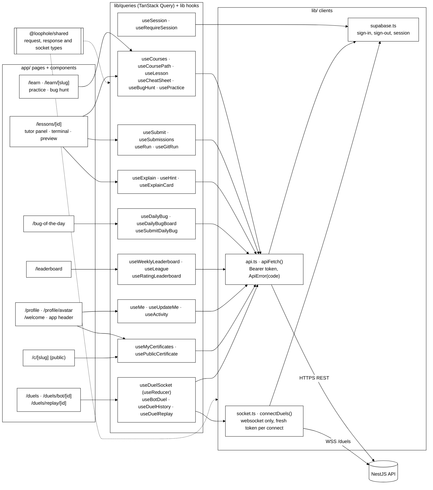
